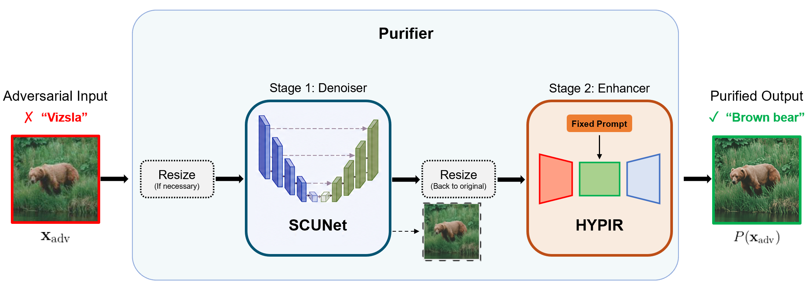
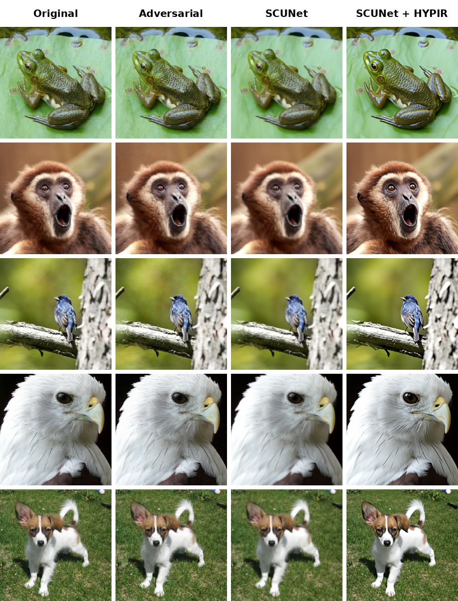

# A Two-Stage Restoration-Based Adversarial Purification Framework

**Nima Mehranfar**<sup>1</sup> ([ORCID](https://orcid.org/0009-0008-3843-2737)), **Fabio Narducci**<sup>1</sup> ([ORCID](https://orcid.org/0000-0003-4879-7138)), **Matteo Polsinelli**<sup>2</sup> ([ORCID](https://orcid.org/0000-0002-4215-2630)), and **Michele Nappi**<sup>1</sup> ([ORCID](https://orcid.org/0000-0002-2517-2867))

<sup>1</sup> Department of Computer Science, University of Salerno, 84084 Fisciano, Italy  
<sup>2</sup> Department of International Humanities and Social Sciences, Università degli Studi Internazionali di Roma, 00147 Rome, Italy  
**Corresponding author:** Fabio Narducci ([fnarducci@unisa.it](mailto:fnarducci@unisa.it))  
**Funding:** This work received no external funding.

This project investigates an inference-only, two-stage adversarial purification framework using off-the-shelf image restoration models. **SCUNet** first suppresses adversarial perturbations through blind denoising, while **HYPIR** restores fine details and classification-relevant information. Both stages use released pretrained weights, without adversarial training, attack-specific fine-tuning, or modifications to the target classifier.

**Publication status:** The manuscript is currently under review. The full source code will be made publicly available in this repository once the review process is complete.

<p align="center">
  
</p>

## 👀 Gallery

The columns show the original image, adversarial input (AutoAttack), denoiser output, and final denoiser + enhancer output.

<p align="center">
  
</p>

## 📊 ImageNet-1K results

The following comparison reports ResNet-50 top-1 accuracy (%) on ImageNet-1K. AutoAttack uses the ℓ∞ threat model with ε = 4/255. PGD-100 also uses ℓ∞ with ε = 4/255 and step size α = 1/255. Published values are shown only where available; `—` means not reported.

<table>
  <thead>
    <tr>
      <th>Defense</th>
      <th>Method</th>
      <th>Standard</th>
      <th>AutoAttack ℓ∞</th>
      <th>PGD-100 ℓ∞</th>
    </tr>
  </thead>
  <tbody>
    <tr>
      <td><strong>Baseline</strong></td>
      <td>ResNet-50<br><sub>No defense</sub></td>
      <td>80.08</td>
      <td>0.00</td>
      <td>0.00</td>
    </tr>
    <tr>
      <td><strong>AT</strong></td>
      <td>Singh et al.<br><sub>2023 NeurIPS</sub></td>
      <td>67.44</td>
      <td>35.54</td>
      <td>—</td>
    </tr>
    <tr>
      <td><strong>Hybrid</strong></td>
      <td>Lei et al.<br><sub>2025 CVPR</sub></td>
      <td>77.63</td>
      <td>74.19</td>
      <td>73.89</td>
    </tr>
    <tr>
      <td rowspan="7"><strong>AP</strong></td>
      <td>Nie et al.<br><sub>2022 ICML</sub></td>
      <td>67.79 ± 0.43</td>
      <td>67.01 ± 0.97</td>
      <td>—</td>
    </tr>
    <tr>
      <td>Wang et al.<br><sub>2022 arXiv</sub></td>
      <td>70.17</td>
      <td>—</td>
      <td>68.78</td>
    </tr>
    <tr>
      <td>Song et al.<br><sub>2024 CVPR</sub></td>
      <td>66.92 ± 10.44</td>
      <td>61.53 ± 9.70<sup>1</sup></td>
      <td>—</td>
    </tr>
    <tr>
      <td>Park et al.<br><sub>2025 ICCV</sub></td>
      <td>71.68–74.05</td>
      <td>52.92</td>
      <td>49.92</td>
    </tr>
    <tr>
      <td>Li et al.<br><sub>2025 Neur. Net.</sub></td>
      <td>73.02</td>
      <td>—</td>
      <td>71.04</td>
    </tr>
    <tr>
      <td>Fan et al.<br><sub>2026 ICASSP</sub></td>
      <td>71.45</td>
      <td>70.32</td>
      <td>69.80</td>
    </tr>
    <tr>
      <td><strong>Ours</strong><br><sub>2026</sub></td>
      <td>75.90</td>
      <td><strong>74.40</strong></td>
      <td><strong>74.04</strong></td>
    </tr>
  </tbody>
</table>

<sup>1</sup> Song et al. report AutoAttack ℓ∞ at ε = 8/255.

For results on AutoAttack ℓ₂, other ImageNet-1K backbones, CIFAR-10, adaptive PGD+EOT, ablations, and runtime, refer to the manuscript.

## 📝 Citation

The manuscript is under review; publication details will be updated when available.

```bibtex
@article{mehranfar2026two_stage_purification,
  title  = {A Two-Stage Restoration-Based Adversarial Purification Framework},
  author = {Mehranfar, Nima and Narducci, Fabio and Polsinelli, Matteo and Nappi, Michele},
  year   = {2026},
  note   = {Manuscript under review}
}
```

## 📄 License and third-party software

Copyright 2026 Nima Mehranfar, Fabio Narducci, Matteo Polsinelli, and Michele Nappi.

The original materials in this repository are licensed under the [Apache License 2.0](https://www.apache.org/licenses/LICENSE-2.0). Licensing information for the full source-code release will be provided when the review process is complete.

The complete purification pipeline depends on separately licensed third-party software and model weights:

- SCUNet is distributed under Apache License 2.0.
- HYPIR is available for non-commercial use unless separate written permission is obtained from its licensor.
- Stable Diffusion 2.1 is governed by its own model license and use restrictions.

The project license does not replace or override those third-party terms.
